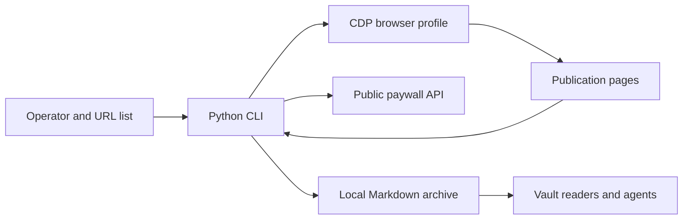

# substack2md security audit, 2026-11-22

## Executive summary

This is a local CLI, not a network service. Its largest privilege is control of a CDP-enabled browser profile. The operator confirmed local use with a regular browsing profile. That makes CDP exposure a high field risk because the profile may hold sessions for services beyond Substack, even when the port is loopback-only. The main code risks are unsafe links entering the archive, unbounded processing of hostile pages, and a vulnerable installed HTTPS trust store. Risk rises further if the CDP port is forwarded, URLs arrive from an untrusted automated feed, or the output directory is public or broadly synced. No remote code execution or arbitrary path escape was demonstrated.

Overall field risk under the confirmed regular-profile use: **high**. The count below separates code and packaging findings from conditional field risks so the same trust-boundary issue is not counted twice.

| Finding class | Critical | High | Medium | Low |
|---|---:|---:|---:|---:|
| Code and packaging findings below | 0 | 0 | 6 | 2 |
| Conditional field risks below | 0 | 2 | 1 | 0 |

Scope: `substack2md/`, `launch-browser.sh`, Python packaging and CI, the static docs and assistant guide, and tests at pre-mitigation commit `c01d2aa`. File:line anchors in the original findings refer to that commit. This is the first audit found in this repository. The assessment is static and uses local synthetic inputs; it did not connect to a real browser, read private posts, probe a hosted service, or test a released wheel or Homebrew formula. The field ranking assumes one operator on a local machine using a regular browsing profile, as confirmed by the operator. Whether that means the default Chrome data directory or another regularly used profile is unverified. Chrome 136 and later require a nondefault data directory for remote-debugging flags; a default-profile launch may fail instead of exposing CDP. The actual browser, version, and binding were not verified. If this is run on a shared or hosted machine, or as an agent over externally supplied URL lists, re-rank the conditional risks upward.

## System and threat model

| Boundary | Data and authority | Existing control | Residual concern |
|---|---|---|---|
| Operator or URL file to CLI | URLs, output location, optional config | HTTP(S) and hostname check in `cli.py:449-452`; path confinement in `_core.py:145-161` | Any HTTP(S) host is accepted; `--from-md --url` has no URL validation. |
| CLI to browser | CDP over loopback by default; page navigation and full DOM access | Dedicated profile and loopback guidance in `SECURITY.md`; target closure in `_core.py:628-673` | CDP has no application authentication; a reachable port grants browser control. The confirmed regular-profile use expands exposed assets. |
| Publication page to CLI | HTML, metadata, links, possibly paid content | `readability` and Markdown conversion; YAML safe dump | Untrusted links and body text enter the archive; page size is unbounded. |
| CLI to public paywall API | Publication and slug, no cookies passed in code | HTTPS and a request timeout in `_core.py:379-410` | Metadata is advisory, and installed `certifi` is affected by a trust-store advisory. |
| CLI to archive and downstream readers | Markdown, optional raw HTML, URL state | Atomic replacement, file mode 0600 in the tested local path, symlink checks and safe YAML loading | Synced/public vaults can redistribute paid content; raw HTML remains active if opened. |

The realistic remote adversary can control a page, its metadata, links and response size, or persuade an operator or automation to process a URL. A remote adversary cannot directly call this CLI or read its local archive under the assumed setup. A local user/process that can reach the CDP port has a much stronger position: the confirmed regular profile may expose other logged-in accounts. The static documentation website has no application endpoints or executable page script; it is a separate, lower-risk surface.

## Findings and priority

### SEC-001, medium: Unsafe link schemes survive article conversion

Evidence: `_core.py:250-290` turns image and iframe sources into links and calls `markdownify` without validating link schemes; `cli.py:206-211` writes the result. A synthetic `<a href="javascript:alert(1)">click</a>` produces `[click](javascript:alert(1))`; `file:///etc/passwd` also survives. `--from-md` preserves such links as well (`cli.py:243-248`). This is a stored unsafe-link and social-engineering path when an archive is opened in a Markdown app or consumed by an agent. Execution in Obsidian was not tested, so this is not a proven Obsidian XSS. Allow only intended schemes for generated links, escape Markdown destinations and labels, and test the target renderer.

### SEC-002, medium: Unescaped labels can forge Obsidian wikilinks

Evidence: `_core.py:715-726` interpolates external page link text into `[[target|text]]` without escaping `]` or `|`. A synthetic label `evil]] [[secret` produced `[evil]] [[target|[secret]]` after rewriting. This can change what a vault reader sees or follows. Escape or neutralize wikilink delimiters in both the label and any path/fragment; add adversarial conversion tests.

### SEC-003, medium: Hostile pages can exhaust local resources

Evidence: `_core.py:655-665` receives the entire DOM as one CDP string; `_core.py:419-492` parses the full HTML multiple times; `cli.py:374-382,392-394,523-527` allows any positive concurrency. The 45-second CDP deadline does not bound parsing after HTML retrieval. A large or pathological article, or many parallel publications, can consume memory or CPU. Set a maximum captured HTML size and bounded worker count, and fail a capture explicitly when limits are exceeded. This is most relevant to unattended batch processing.

### DEP-001, medium: The audited environment has an affected certificate bundle

Evidence: the local `.venv` has `certifi==2025.11.12`; `pip-audit` flags `GHSA-6q48-6c7w-9gw2`, patched in `2026.10.18` and recommended by the advisory at `2026.10.19` or later. `requests.get` in `_core.py:383-410` uses normal certificate verification for paywall metadata. An on-path attacker with one of the compromised CA keys could alter that HTTPS response, including `is_paid`. The call sends no browser cookies, and it is opt-in; the main CDP browser connection does not use this bundle. Refresh the installed environment and set a safe transitive minimum or a tested lock/constraints file for releases. Source: [certifi advisory](https://github.com/advisories/GHSA-6q48-6c7w-9gw2).

### SEC-004, medium: Full URLs can reach logs

Evidence: `cli.py:165-172,212-228` logs original URLs, including on failure; `cli.py:510-513` reports failures in batch mode. `_core.py:176-181` strips query parameters for saved metadata, but logging uses the uncleaned URL. A URL with a token or private path can enter terminal capture or job logs. Log a redacted origin/path or cleaned URL, and avoid including response exception strings that may repeat a sensitive URL.

### SEC-005, medium: Dependency and build inputs are not reproducible or gated by security checks

Evidence: `pyproject.toml:31-39` sets lower bounds without upper bounds or a lock; `.github/workflows/tests.yml:13-19` installs fresh dependencies and uses mutable action tags; no dependency update or audit workflow was found. This increases supply-chain drift for a tool that controls an authenticated browser. Add a tested constraints or lock artifact for release builds, an advisory check, and commit SHA pinning for CI actions. Keep the user install path and assistant guide aligned with the chosen release policy.

### SEC-006, low: The launch helper can terminate unrelated processes

Evidence: `launch-browser.sh:40-53` detects a listener on port 9222, then with a single prompt runs `kill $(lsof -t -i:$PORT)`. The second `lsof` query is broader than the first and can include other processes using that port. Show the exact listening PID and executable, and require the operator to close it manually or terminate only that verified listener.

### SEC-007, low: No explicit hard limit on generated archive size or retention

Evidence: `--also-save-html` writes raw captured HTML next to Markdown (`cli.py:207-211`), and the state file records archive paths (`_core.py:841-869`). Existing file modes are restrictive in the tested local path, but the tool has no limit on sidecar size or retention policy. Document that sidecars may contain private, executable page content; keep this option off for routine captures and set restrictive archive permissions when outputs are synced.

## Conditional field risks

| ID | Priority in stated condition | Abuse path and impact | Existing control and action |
|---|---|---|---|
| FIELD-001 | High for the confirmed regular-profile use; critical only if exposed to an untrusted network peer | A local process, or a network peer if the port is exposed, connects to the debugging endpoint and controls or reads tabs in a profile used for other accounts. | `SECURITY.md:3-25` recommends isolation. Verify the actual listening interface, never forward the port, and move capture to a dedicated profile with only the needed Substack session. Chrome 136+ may refuse debugging of the default data directory, but that is not a control for every browser or profile: [Chrome guidance](https://developer.chrome.com/blog/remote-debugging-port). |
| FIELD-002 | High if archives are published or shared automatically | A paid post is captured with browser cookies and written in full. `--detect-paywall` is opt-in, returns unknown on failures, and adds metadata rather than blocking output (`cli.py:143-171,206-211`). | `README.md:322-335` warns about redistribution. Require an explicit human gate or fail-closed publication policy downstream; keep private archives separate from public sync roots. |
| FIELD-003 | Medium, higher for unattended URL feeds | A crafted URL list navigates the authenticated browser to any HTTP(S) host, including an internal site, then archives what the profile can access (`cli.py:449-452`, `_core.py:649-665`). Plain HTTP also lets an on-path adversary alter the page. | The operator supplies URLs in normal use. For automated feeds, require HTTPS and restrict hosts and `/p/` paths by default, with an explicit custom-domain allowlist. This is not a claim that the CLI sends archived content to the attacker. |

## Automated scan and reachability notes

- Bandit 1.9.4 scanned 1,266 lines in `substack2md/`: 0 medium/high, 3 low (`B112` twice, `B110` once). The `B110` at `_core.py:672` suppresses a target-close failure in cleanup; it is not a demonstrated security bypass.
- `pip-audit` 2.10.0 inspected 30 packages in `.venv/lib/python3.14/site-packages`: 43 raw records, 26 distinct package/advisory pairs, 9 affected packages. The feed repeated some IDs. The initial empty scan against a nonexistent Python 3.13 directory was discarded.
- Installed packages are not proof that every affected API is used. The `lxml` XXE advisory concerns `iterparse`/`ETCompatXMLParser`, neither called by this repo; the `requests` advisory concerns `extract_zipped_paths`, also not called. Soup Sieve receives fixed selectors in this repo, so its selector-input advisories have lower direct reachability. Update affected dependencies, then rerun the audit against the exact release environment. The table gives scanner-reported minimum fixes; compatibility of those versions with this project was not tested.

| Installed package | Version | Distinct advisories | Scanner-reported fix | Reachability note |
|---|---|---:|---|---|
| certifi | 2025.11.12 | 1 | 2026.10.18 | Relevant to optional `requests` TLS; advisory recommends 2026.10.19 or later. |
| idna | 3.11 | 1 | 3.15 | Very long crafted hostname required; ordinary user URLs are much shorter. |
| lxml | 6.0.2 | 1 | 6.1.0 | Affected XML parser APIs not called here. |
| lxml-html-clean | 0.4.3 | 3 | 0.4.5 | Affected Cleaner behavior needs upstream/consumer path review. |
| requests | 2.32.5 | 1 | 2.33.0 | Affected zip-path helper not called here. |
| soupsieve | 2.8 | 8 | Up to 4.0.0 | Repo uses fixed CSS selectors, not attacker-supplied selector strings. |
| urllib3 | 2.6.1 | 5 | Up to 2.8.0 | Several advisories concern low-level streaming or proxy APIs not used directly. |
| pip | 25.3 | 5 | Up to 26.2.0 | Installer/build environment, not CLI runtime. |
| setuptools | 84.0.0 | 1 | 84.1.0 | Legacy Windows wheel install path, not CLI runtime. |
- No tracked `.env`, private key or PEM files; no additions of those patterns found in Git history. Targeted tracked-file secret patterns found no candidate. `.gitignore` covers `.env` and `config.yaml`. This is not a full entropy or history scan.
- `pytest -q`: 127 passed, 1 skipped. The skipped test is the optional live public Substack API smoke test, not a browser test. Synthetic unsafe-link and wikilink cases above were reproduced locally. No live CDP or hosted test was performed.

## OWASP coverage and positive controls

| Category | Assessment |
|---|---|
| A01 Broken access control | No server routes; local archive path and symlink defenses reviewed. |
| A02 Cryptographic failures | No custom cryptography; affected `certifi` trust store is the relevant TLS issue. |
| A03 Injection | Unsafe Markdown link and wikilink construction found; no shell input reaches `eval` in the Python runtime. |
| A04 Insecure design | CDP privilege, subscriber-content publication, and hostile URL feeds are the key field risks. |
| A05 Security misconfiguration | Dedicated profile and loopback guidance are present; launcher PID handling needs tightening. |
| A06 Vulnerable components | 26 distinct installed advisory pairs; most need reachability review rather than severity transposition. |
| A07 Authentication failures | CLI has no application auth; CDP endpoint is browser-controlled and sensitive. |
| A08 Data integrity | Atomic artifact writes and recovery markers exist; dependency and CI inputs remain mutable. |
| A09 Logging | Full URLs can enter logs. |
| A10 SSRF | No application server; unattended untrusted URL lists can turn the authenticated browser toward internal HTTP(S) sites. |

Positive controls: `yaml.safe_load` for config and note indexing, `yaml.safe_dump` for frontmatter, archive-root confinement and symlink checks, atomic replacement with recovery markers, a 0600 state file, timeouts on CDP and paywall requests, a dedicated browser profile in setup docs, and three byte-identical assistant-guide copies with matching local manifests. Those guide hashes verify local consistency, not publisher authenticity or hosted conformance.

## Follow-up order and limits

1. P1: Validate CDP binding and profile isolation for actual field deployments; keep archives with paid content out of public sync or publication paths.
2. P2: Reject or neutralize unsafe link schemes and escape wikilink delimiters, then add renderer-specific adversarial tests.
3. P2: Cap HTML size and worker count; constrain automated URL feeds.
4. P2: Refresh and constrain dependencies, especially `certifi`, and add advisory/build integrity gates.
5. P2/P3: Redact URL logs, make sidecar handling explicit, and fix the launch helper's process selection.

At audit time, no issues or source fixes were made. A repeat audit should compare this first baseline against the then-current source and installed release environment. Severity is conditional where it depends on browser profile use, URL provenance, and archive sharing.

## Mitigation progress, 2026-11-22

The operator confirmed that a dedicated profile is acceptable, Substack and custom publication domains must remain supported, and archive output is private and local. Local commit `247c4d0` filters generated HTML links by scheme, resolves relative destinations against the article URL, escapes Markdown link syntax, and leaves links with unsafe wikilink delimiters in standard Markdown form. Synthetic bypass and legitimate-link tests pass. `SEC-001` is partially mitigated because `--from-md` imports remain unchanged; `SEC-002` is mitigated for generated links. The macOS launcher now refuses an occupied CDP port instead of killing a process, mitigating `SEC-006`. The commit is local, unpushed, and not a published release. Dedicated-profile use has not been verified in a live browser.

## Documentation audit follow-up, 2026-11-22

The original paywall request assessment said no credentials were sent. The code supplies no explicit credentials, but `requests.get` uses a default session with `trust_env=True` and may attach matching `.netrc` credentials or route through configured proxies. The API does not require authentication. `SECURITY.md` and `README.md` now state the limit. Disabling ambient authentication in the paywall request remains an open code mitigation; this follow-up is separate from the original finding counts above.

## Final-release candidate disposition, 2026-11-22

[FINAL_RELEASE.md](../../FINAL_RELEASE.md) records every finding as shipped, mitigated in the local candidate, an explicit trust boundary or remaining acceptance work. The original finding counts and pre-mitigation evidence above remain a historical baseline. The candidate anonymous metadata session disables trust_env and redirects; raw CLI URL/error logs are removed; capture size, worker count, HTTPS admission and dependency floors are bounded and tested. This is local preparation after published v2.2.1, not evidence of final publication or authenticated browser acceptance.
