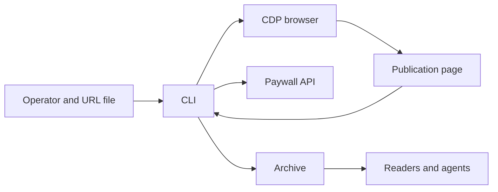

# substack2md threat model, 2026-11-22

## Executive summary

The critical trust boundary is the local CDP endpoint. The operator confirmed that field use involves a regular browsing profile, so a process that reaches that endpoint may gain access to sessions beyond Substack. Publication-controlled HTML also becomes Markdown or optional raw HTML in a local archive, where unsafe links and instructions may influence readers or agents. The paired [security audit](docs/security/audits/audit-2026-11-22.md) has code findings, dependency results, and reproduction evidence.

## Scope and assumptions

Runtime scope: `substack2md/`, `launch-browser.sh`, local archive output, optional paywall API at pre-mitigation commit `c01d2aa`. File:line anchors in the original model refer to that commit. Build and delivery scope: `pyproject.toml`, `.github/workflows/tests.yml`, assistant guide and static docs. Tests and synthetic fixtures are evidence, not field inputs. The operator selected local use with a regular browser profile at the audit check-in, then confirmed a dedicated profile is acceptable for mitigation. The actual browser and version, CDP bind address, URL-list provenance, and whether a default or custom profile directory is used remain unverified. Chrome 136+ may reject remote debugging of its default data directory; that limitation does not establish safe use of another regular profile. No live browser was probed.

## System model

### Primary components

- `cli.py:312-543` accepts arguments and URL files, manages workers, and writes archive artifacts.
- `_core.py:575-673` connects to a CDP browser, navigates a tab, and returns its DOM.
- `_core.py:419-539` extracts article fields and converts HTML; `_core.py:758-784` serializes frontmatter.
- `_core.py:383-411` optionally requests public paywall metadata without browser cookies.
- `_core.py:681-873` indexes existing notes, rewrites links, and maintains resume state.
- `launch-browser.sh:13-90` starts a browser with a dedicated profile by default; the confirmed regular-profile usage differs from this helper's design.

### Data flows and trust boundaries

- Operator or URL file to CLI: strings and paths over arguments/files. The batch path checks for an HTTP(S) hostname (`cli.py:449-452`), but accepts any host and HTTP; `--from-md --url` skips that check.
- CLI to CDP browser: unauthenticated local HTTP/WebSocket by default (`_core.py:575-599`). The client can navigate and read DOM (`_core.py:628-665`). The browser profile determines the scope of exposed credentials.
- Browser to publication page: normal browser navigation with that profile's ambient state. The page controls HTML, metadata, links, and size.
- Publication HTML to archive: conversion and YAML serialization (`_core.py:419-539,758-784`); link schemes and wikilink delimiters are not fully sanitized.
- CLI to paywall API: HTTPS `requests.get` with timeout and no cookies (`_core.py:383-411`); installed CA bundle has a relevant advisory.
- Archive to vault readers/agents: Markdown and optional raw HTML, potentially containing paid content and attacker-authored text (`cli.py:174-211`). File mode was 0600 in a local synthetic test; synced/public destinations change the boundary.

#### Diagram

## Assets and security objectives

| Asset | Why it matters | Objective |
|---|---|---|
| Browser sessions and cookies | Regular profile may include unrelated accounts | Confidentiality, integrity |
| Authenticated article text | Paid or private content can be captured | Confidentiality |
| Archive files and metadata | Notes may be trusted, synced, or published later | Confidentiality, integrity |
| Host resources | Large pages and batches can consume CPU, memory, and disk | Availability |
| Install and CI inputs | Compromise can execute code with the operator's browser access | Integrity |

## Attacker model

### Capabilities

A remote publication or compromised page can control response HTML, article metadata, links, scripts in the visited browser, and response size. A third party may supply a URL list to an automated workflow. A local process or user may connect to a reachable CDP port. An on-path attacker may influence vulnerable TLS validation only if it has the necessary compromised CA key and network position.

### Non-capabilities

Under local, loopback-only use, a remote page cannot directly invoke the CLI, read archive files, or connect to CDP simply by knowing the port. A crafted Markdown link is not proof of code execution in a particular renderer. Published-page scripts remain subject to browser security boundaries unless another browser vulnerability or misconfiguration exists.

## Entry points and attack surfaces

| Surface | How reached | Boundary | Evidence |
|---|---|---|---|
| CLI URL arguments and file | Operator or automation | Input to privileged navigation | `cli.py:325-335,410-452` |
| Raw Markdown import | `--from-md` | Imported text to archive | `cli.py:232-305` |
| CDP discovery and socket | Configurable host and port | Local process to browser authority | `_core.py:575-599` |
| Article HTML and metadata | Browser DOM | Remote content to local parser | `_core.py:419-539` |
| Paywall metadata | Optional API | Network result to archive classification | `_core.py:383-411` |
| Archive/state/sidecar | Local filesystem or sync | Private content to later consumers | `cli.py:70-113,174-211`; `_core.py:791-873` |
| Installer and guide | GitHub, Homebrew, local assistant | Third-party code to local execution | `README.md:28-80`; `assistant-guide.txt` |

## Top abuse paths

1. A local process discovers a CDP listener, attaches to the regular profile, and reads or controls other authenticated tabs. The same path becomes remote if the port is bound or forwarded to an untrusted peer.
2. An attacker supplies a URL list to unattended automation. The CLI accepts a non-Substack HTTP(S) host, navigates it with the regular profile, and archives accessible content. The CLI itself does not transmit that archive to the attacker.
3. A hostile publication includes a `javascript:` or `file:` link. Conversion preserves it in Markdown; a reader or downstream app follows a dangerous destination. Renderer-specific execution is unverified.
4. A hostile page uses `]` or `|` in a link label. Internal-link rewriting produces malformed or forged Obsidian wikilinks that mislead a reader.
5. A hostile or compromised publication serves a very large page. The browser returns the full DOM and the CLI parses it repeatedly; parallel jobs amplify CPU and memory pressure.
6. A paid article is written to an archive that is later published or broadly synced. The optional paywall flag annotates but does not prevent output, and unknown metadata is possible.
7. An attacker compromises a package or mutable CI dependency. A fresh install or build executes the new code in an environment that can later access CDP. This is a supply-chain scenario, not a demonstrated compromise.

## Threat model table

| ID | Source and prerequisite | Action and impact | Existing control | Gap and mitigation | Detection | Likelihood | Impact | Priority |
|---|---|---|---|---|---|---|---|---|
| TM-001 | Local process; regular CDP profile | Control/read browser sessions | Loopback and dedicated-profile guidance | Use a dedicated profile, verify listener, never forward port | Inspect listener and unexpected tabs | Medium | High | High |
| TM-002 | Untrusted URL feed; automation | Navigate internal or arbitrary site and archive result | HTTP(S) hostname validation | Restrict host/path and HTTPS; allowlist custom domains | Record rejected host counts without URL secrets | Medium | Medium | Medium |
| TM-003 | Hostile article; downstream reader | Unsafe or forged links mislead reader | HTML conversion strips script/style tags | Filter schemes and escape Markdown/wikilink syntax | Scan produced links in test fixtures | High | Medium | Medium |
| TM-004 | Hostile page or huge batch | Resource exhaustion | CDP timeout and default concurrency 1 | Bound HTML size, parse time, worker count | Capture size and failure metrics | Medium | Medium | Medium |
| TM-005 | Public or synced archive | Redistribute paid/private content | Paywall metadata option and README warning | Separate private output and gate publication on explicit status/review | Review public-sync inventory | Medium | High | High |
| TM-006 | On-path attacker with compromised CA key | Alter opt-in paywall metadata | HTTPS certificate verification | Update affected `certifi`; test exact release environment | Dependency audit and metadata anomaly checks | Low | Medium | Medium |
| TM-007 | Compromised dependency or CI input | Execute code with local user privileges | Tests and assistant-guide approval steps | Lock release inputs and audit dependencies; pin CI actions | CI artifact provenance and advisory checks | Low | High | Medium |

## Criticality calibration

- Critical: CDP exposed to an untrusted network with a regular profile, or proven code execution via a remotely supplied article that compromises that profile.
- High: local CDP reachability by other users/processes holding unrelated account sessions, or automatic public release of paid/private archives.
- Medium: stored unsafe links requiring user interaction, untrusted URL-feed navigation, hostile-page denial of service, or opt-in metadata tampering under an on-path attacker.
- Low: launch-helper process selection errors or sidecar retention confusion when the archive stays private.

These priorities depend most on whether the CDP listener is reachable beyond the operator and whether archive outputs are later shared. The operator confirmed regular-profile use, which is reflected in TM-001.

The operator later confirmed that a dedicated profile is acceptable and the archive is private and local. The high rating for TM-001 remains relevant until the field setup actually uses that isolated profile and its listener is verified. TM-005 becomes lower likelihood for the stated local-only archive, but should be rechecked if output is synced or published.

Documentation audit follow-up, 2026-11-22: The paywall API call supplies no explicit authentication, but the default Requests session may load matching `.netrc` credentials or use environment proxies. The API does not require credentials. Treat ambient authentication as an open implementation gap at the CLI-to-API boundary until disabled and tested.

## Focus paths for security review

| Path | Why it matters | Threats |
|---|---|---|
| `substack2md/_core.py` | CDP authority, hostile HTML, link rewriting, paywall metadata | TM-001, TM-003, TM-004, TM-006 |
| `substack2md/cli.py` | URL admission, concurrency, archive writing | TM-002, TM-004, TM-005 |
| `launch-browser.sh` | Profile and listener setup | TM-001 |
| `pyproject.toml` | Dependency admission | TM-007 |
| `.github/workflows/tests.yml` | Build and test input integrity | TM-007 |
| `README.md` and `SECURITY.md` | Field setup and content-sharing guidance | TM-001, TM-005 |
| `assistant-guide.txt` | Agent-mediated installation instructions | TM-007 |

## Quality check and open questions

All discovered runtime input paths, the CDP boundary, the archive-reader boundary, and the optional API are represented above. Runtime and build/CI threats are distinct. The operator's regular-profile answer is incorporated. To refine priority, verify the actual browser/version and CDP listener, whether the regular profile is the default data directory, URL-list provenance, and whether archive output enters a public sync or publishing workflow.
